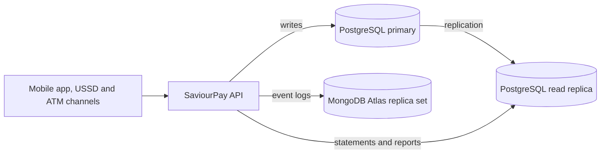

# Portfolio 5: Distributed and Cloud Database Exercise

**Case study:** SaviourPay Digital Bank (Simulated).

## What was built and what is design only

| Part | Status |
|---|---|
| MongoDB Atlas cluster with replication (3-node replica set) | **Built and observed** |
| PostgreSQL replication, sharding and AWS deployment | **Design discussion only, not built** |

## 1. Replication: evidence from MongoDB Atlas

The `SaviourPayCluster` on MongoDB Atlas (free M0 tier, AWS Paris, eu-west-3) runs as a **replica set with 3 nodes**. One node is the primary and takes all writes. The others are secondaries that copy the primary's data. If the primary fails, the secondaries elect a new primary automatically, so the transaction logs stay available.

Screenshot of the cluster page showing "Replica Set - 3 nodes" is in the final documentation.

Limitation: sharding is not available on the free M0 tier, so it was not set up.

## 2. Proposed architecture

## 3. Proposed PostgreSQL deployment on AWS (not built)

- **Amazon RDS for PostgreSQL** with a **Multi-AZ** standby: if the primary fails, RDS fails over automatically, which protects availability of the ledger.
- A **read replica** serves read-heavy work such as account statements and the weekly branch report (Query 2), so it does not compete with transfers on the primary.
- Placed in private subnets, with encryption at rest and in transit, automated backups and point-in-time recovery.
- Choose the AWS region closest to Nigerian users. Check which regions are currently available before committing to one.

## 4. Sharding design (not built)

If transaction volume outgrew one server, `transactions` could be split across shards.

- **Shard key: hash of `account_id`.** Each account's history stays on one shard, so Query 1 (mini statement for one account) touches a single shard, and the load spreads evenly.
- **Rejected alternative: range by `created_at`.** It is simple, but all new writes would land on the newest shard (a hot spot).
- **Cost of this choice:** Query 2 (weekly report across all branches) would have to query every shard and merge the results.
- **Hard part:** a transfer between accounts on different shards cannot rely on a single local transaction. It would need a distributed commit (two-phase commit) or a saga with compensating reversals, which fits the reversal rows already in the design.

## 5. Consistency vs availability

- **Ledger (PostgreSQL):** consistency comes first. Balances and transfers must be correct, so all writes go to the primary. If the primary is unreachable and no failover has completed, writes wait or fail instead of risking two versions of a balance.
- **Statements from a read replica:** may lag slightly behind the primary (eventual consistency). This is acceptable for history, but not for checking available balance before a payment.
- **Logs (MongoDB):** write availability matters more than instant consistency, so the replica set's automatic failover suits them.

## Analysis

SaviourPay uses two databases for two kinds of data. Money needs strong consistency, so it stays on a single writable PostgreSQL primary with standbys for availability. Event logs need to keep flowing, so they run on a replicated MongoDB cluster. Sharding by account would scale writes, but it makes cross-account reports and transfers harder, so I would only add it when one server can no longer cope.
